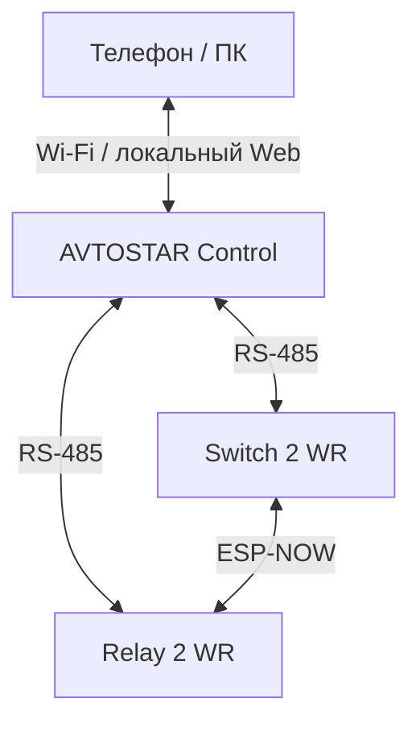

# Архитектура AVTOSTAR Home

## Топология

Конечные устройства Switch 2 и Relay 2 используют ESP-12F. Вариант W работает через Wi-Fi и ESP-NOW, вариант WR также подключается к общей шине RS-485. Для Control рассматривается ESP32-S3.

## Взаимодействие

| Режим | Принцип работы |
|---|---|
| W ↔ W | Прямой обмен ESP-NOW без маршрутизатора |
| WR ↔ WR | Полудуплексный обмен по RS-485 с управлением доступом к шине |
| WR ↔ WR (беспроводной) | Прямой обмен ESP-NOW независимо от проводного соединения |
| W/WR ↔ Control | Управление, синхронизация состояния, сценарии |

Устройства хранят привязки и настройки локально. Отказ Control не должен нарушать автономное беспроводное управление. Для RS-485 используется один активный инициатор или координатор обмена; одновременно передавать данные нескольким узлам нельзя. Шлюз должен исключать повторное выполнение команд и циклы пересылки.

ESP-NOW используется для прямого обмена между узлами; маршрутизация через промежуточные узлы требует отдельного протокола.

## Аппаратная основа разработки

[ESP-12F Debug Module v1.0](../hardware/esp12f-debug-module/) предоставляет питание 3,3 В от 5 В, пять универсальных GPIO, ADC и RS-485. GPIO16 управляет DE и /RE MAX3485. UART0 используется для обмена и прошивки; перемычка J1.4–J1.5 разъединяет RXD и RO при программировании.

## Программная архитектура

- Ядро: идентификатор, привязки, состояния, watchdog и авторизация.
- Транспорт: ESP-NOW и UART/RS-485, контроль соединения и повторные передачи.
- Протокол: версия, адреса, номер последовательности, команда, CRC; аутентифицированная оболочка для беспроводного обмена.
- Роли: Switch 2, Relay 2, Control.
- Управление: локальный Web/PWA, сценарии, диагностика и проверяемые OTA-обновления.

[Аппаратная часть RS-485](rs485-hardware.md) · [Протокол](protocol.md) · [Дорожная карта](roadmap.md).
