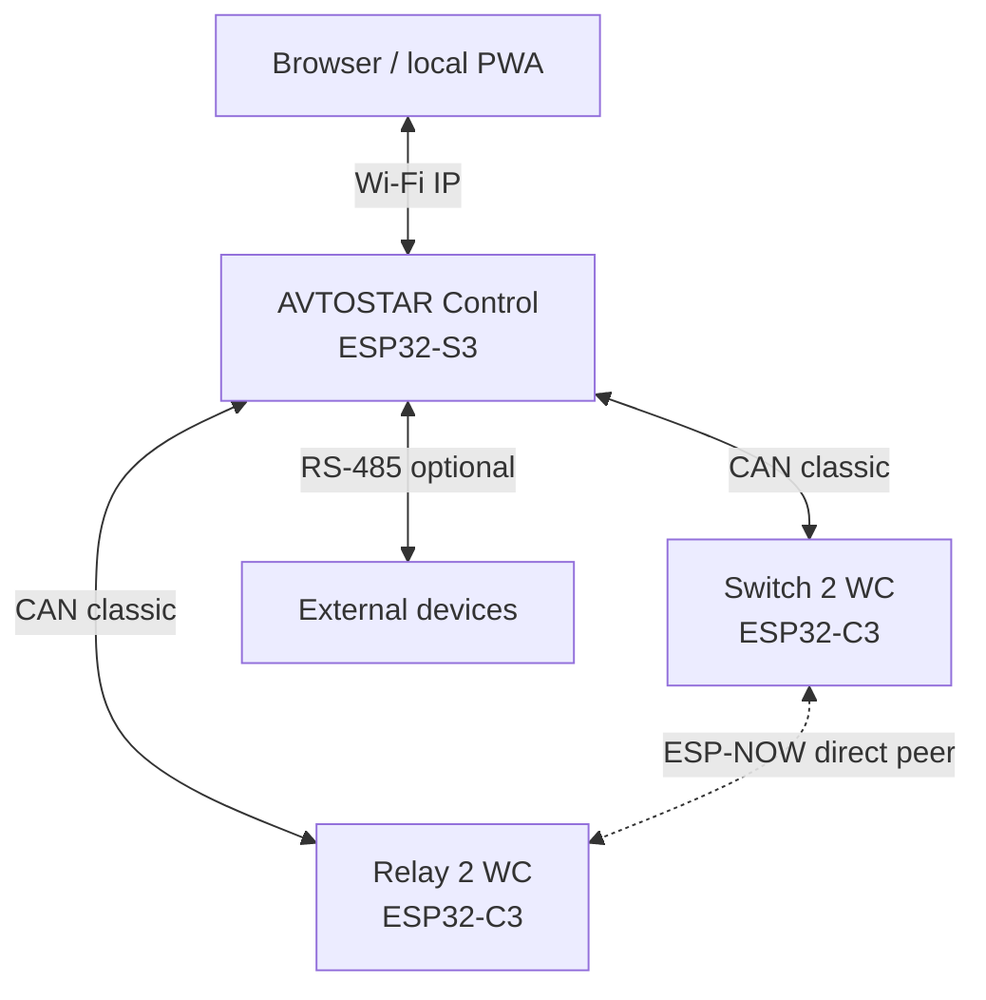

# Architecture — draft

- Switch 2 ↔ Relay 2 remains functional **without Control** after safe commissioning and persistent binding.
- The endpoints share a logical device address and command vocabulary across CAN and wireless transport.
- Gateway translates transport envelopes, not raw CAN frames indiscriminately.
- The gateway cannot assume that a command crossed a transport successfully without a response.
- Distinct transport modules should follow interfaces: `send(packet)`, `receive(packet)`, `health()`.
- A transport failover policy uses link health and delivery status; no uncontrolled broadcast loop.

## Communication modes

1. **W → W:** ESP-NOW peer communication, no router or central controller needed.
2. **WC → WC:** wired CAN, optionally wireless backup once arbitration is designed.
3. **W/WC → Control:** gateway status, configuration, rules, diagnostics and web control.
4. **Control unavailable:** bindings and local endpoint logic still operate.

## Wireless constraints

ESP-NOW supports direct peer messaging, not automatic multi-hop routing. Planned multihop mesh must be a separate module with route discovery, TTL, loop avoidance, packet replay handling and actual RF tests. A single Wi-Fi radio also imposes channel and concurrent AP/STA constraints. Never promise transparent Wi-Fi/ESP-NOW/mesh handoff until tested.

## Hardware and power boundaries

- Endpoint base: ESP32-C3 with proven antenna keepout and RF layout.
- CAN on WC: ESP32-C3 internal TWAI + external CAN transceiver, EMC and ESD protection, switchable 120 Ω termination only at bus ends.
- Switch: external dual touch channels and indicator drivers.
- Relay: electrical isolation, fusing, load rating and snubbers based on voltage/load class.
- Control: ESP32-S3, separate CAN transceiver, RS-485 transceiver; Ethernet optional after requirements review.

## Suggested firmware modules

- `core`: config, identity, message dispatcher, device state, watchdog, telemetry.
- `transports`: CAN, ESP-NOW; IP and optional MQTT at gateway.
- `roles`: switch input handling, relay safe output controller, gateway rules.
- `web`: gateway web UI and API, authentication and permissions.
- `ota`: signed image verification, staged update, rollback validation.

> These are architectural targets. Current repository firmware is only a compile scaffold.
