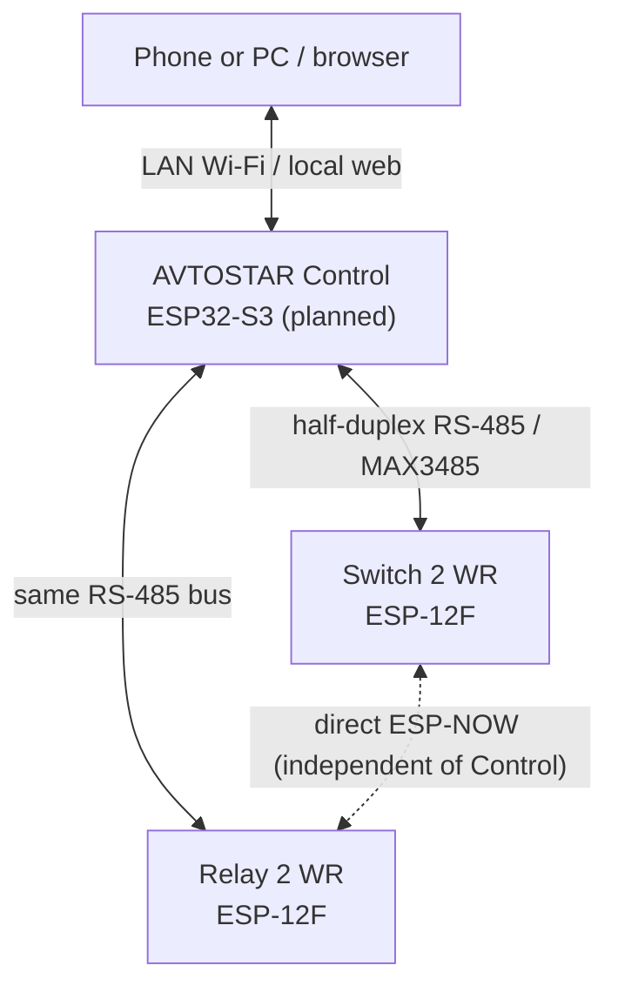

# Architecture — selected ESP-12F + RS-485 direction

- Endpoints: ESP-12F (ESP8266), ESP-NOW on all versions; optional MAX3485 on WR assembly.
- Central Control: ESP32-S3 provisional, browser/PWA and bridge via its own RS-485 transceiver.
- The wired RS-485 segment is a **shared electrical bus**, not point-to-point connections to each endpoint.
- Gateway loss must not break **already commissioned wireless ESP-NOW** switch-to-relay bindings.
- Wired autonomous operation for a two-node pair can use a strict command/reply initiator/responder model; multi-node self-organizing RS-485 needs bus scheduling and recovery, **not yet implemented**.
- Gateway must not create repeated commands or forwarding loops between Wi-Fi and RS-485.

## Transport behavior

| Mode | Endpoint behavior | Current readiness |
| --- | --- | --- |
| W ↔ W | Direct ESP-NOW without router | Planned |
| WR ↔ WR | RS-485 UART with mutually exclusive transmission | Planned, MAC scheduling TBD |
| WR ↔ WR wireless | Direct ESP-NOW, even if RS-485 omitted/disconnected | Planned |
| W/WR ↔ Control | Web control through gateway, state sync, scenes | Planned |

Do **not** claim automatic RS-485 failover, multi-master election or multihop Wi-Fi mesh as implemented. For initial WR trials, designate exactly one RS-485 bus initiator and schedule response windows; expand to a token or single-coordinator protocol only after tests.

## Constraints

- ESP-12F exposes a limited number of usable GPIOs. GPIO0/GPIO2/GPIO15 are bootstrapping-sensitive.
- UART0 GPIO1/TX + GPIO3/RX is the natural MAX3485 port but also used for firmware flashing and boot logs. Provide isolation/programming circuitry and explicit DE defaults.
- MAX3485: half-duplex differential transceiver, 3.3 V supply, UART carries *serial framed bytes*; no CAN frame/ID or TWAI controller.
- For stable RS-485, bus topology, termination, idle biasing, reference conductor, surge and ground potential differences must be assessed.
- ESP-NOW without a router is *peer-to-peer*, not an automatically routed mesh. Wi-Fi radio channel coexistence is a test item.

## Software partitions

- Core: device ID, persistent binding, state, watchdog, authorization.
- Transport: ESP-NOW and UART/RS-485; connection status and retries.
- Protocol: version, source/destination, sequence, opcode, CRC over RS-485; a separate authenticated wireless envelope.
- Roles: 2-button Switch 2, 2-output Relay 2, optional Control gateway.
- Web/OTA: local authenticated control and verified updates; **not implemented**.

See [RS-485 hardware notes](rs485-hardware.md) and [protocol](protocol.md).
